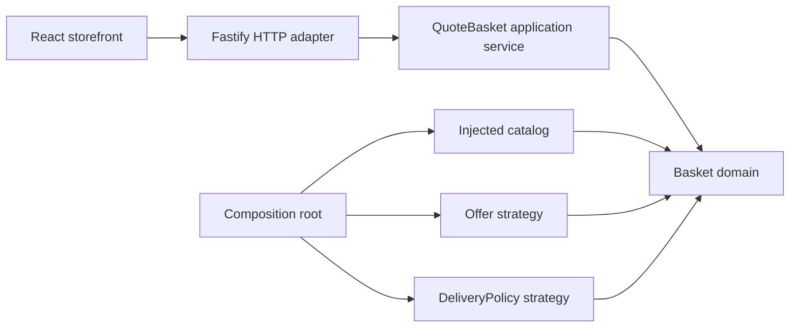

# Acme Widget Co.

A small sales-system proof of concept with a carefully modeled basket, a responsive React storefront, and a production container ready for Google Cloud Run.

[](https://github.com/elitecoderdev/acme-widget-co/actions/workflows/ci.yaml)

Designed, implemented & documented by **elitecoderdev — Luis Jimenez**.

## Start here

With Docker Desktop running Linux containers:

```sh
git clone git@github.com:elitecoderdev/acme-widget-co.git
cd acme-widget-co
docker compose up --build --detach --wait
```

Open **[http://localhost:8080](http://localhost:8080)**. Stop it with `docker compose down`.

Without Docker, install Node.js **24.21.0** and pnpm **11.25.0**:

```sh
npm install --global pnpm@11.25.0 --ignore-scripts
pnpm install --frozen-lockfile
pnpm dev
```

Open **[http://localhost:5173](http://localhost:5173)**. Vite proxies API requests to port 8080. Use Ctrl+C to stop both development servers.

To run the production build directly:

```sh
pnpm build
pnpm start
```

The production storefront and API are served together on port 8080. Optional runtime configuration goes in an ignored `.env` file; `.env.example` contains safe local values. No credentials, database, paid service, or cloud account are needed locally.

## What the application does

Choose widgets, adjust quantities, remove items, or load one of the four supplied example baskets. The API applies offers and delivery charges automatically. Every monetary amount in an API response is an integer number of USD cents.

The storefront shows the original subtotal, savings, delivery, estimated total, and progress toward free delivery. On phones, a fixed basket link keeps the selected items within easy reach. Failed requests preserve the current selection and provide a retry. A request times out after ten seconds instead of leaving an indefinite spinner.

This is a **quotation tool**. It does not collect payment, place orders, reserve inventory, or send customer information. The basket is kept in memory in the browser; refreshing the page starts a new basket. Sample baskets replace the current selection, as stated beside the controls.

## Challenge requirements and decisions

| Requirement                                | Implementation                                                    |
| ------------------------------------------ | ----------------------------------------------------------------- |
| Modern Node.js / TypeScript backend        | Fastify with strict TypeScript                                    |
| React / TypeScript interface               | Vite, React, responsive CSS, native SVG artwork                   |
| Inject catalog, delivery rules, and offers | `Basket` constructor receives explicit dependencies               |
| `add(productCode)`                         | Chainable `Basket.add(code, quantity = 1)`                        |
| `total()`                                  | Numeric dollar amount; `quote()` provides a cent-based breakdown  |
| Extensible offers                          | `Offer` strategy interface                                        |
| Extensible delivery                        | `DeliveryPolicy` interface and tiered implementation              |
| Clear separation and dependency injection  | Hexagonal pricing core with an application layer and HTTP adapter |
| Testing at least 95%                       | Enforced statements, branches, functions, and lines gate          |
| Local and GCP runtime                      | Same non-root image; optional Cloud Run Terraform                 |
| Documentation and API exploration          | `docs/`, Postman collection, environment, and operational guides  |

### Pricing

| Product      | Code  | Unit price |
| ------------ | ----- | ---------: |
| Red Widget   | `R01` |     $32.95 |
| Green Widget | `G01` |     $24.95 |
| Blue Widget  | `B01` |      $7.95 |

Every second red widget costs **$16.47**. Half of $32.95 is $16.475; rounding the discounted unit down reproduces the supplied examples. This is an explicit assumption because the challenge does not define fractional-cent behavior. Rounding is applied **per discounted unit**, so four red widgets cost $98.84 before delivery, not $98.85.

Delivery is calculated **after offers**:

| Discounted merchandise | Delivery |
| ---------------------- | -------: |
| Empty basket           |    $0.00 |
| Less than $50.00       |    $4.95 |
| $50.00 through $89.99  |    $2.95 |
| At least $90.00        |     Free |

The empty-basket exception is another explicit assumption. Catalog prices include the entire merchandise charge for this exercise; no additional taxes, currency conversions, or payment fees are modeled. The strongest applicable offer wins for each line; offers do not stack. Quantities are positive whole numbers, with at most 100 units across the basket. Duplicate input lines are normalized. Unknown product codes are rejected.

| Supplied basket           | Merchandise after offers | Delivery |      Total |
| ------------------------- | -----------------------: | -------: | ---------: |
| `B01, G01`                |                   $32.90 |    $4.95 | **$37.85** |
| `R01, R01`                |                   $49.42 |    $4.95 | **$54.37** |
| `R01, G01`                |                   $57.90 |    $2.95 | **$60.85** |
| `B01, B01, R01, R01, R01` |                   $98.27 |     Free | **$98.27** |

## Architecture

The solution is a **modular monolith with a hexagonal pricing core**. Its scope is deliberately small: the domain has no framework, HTTP, browser, persistence, or cloud dependency. The application layer orchestrates a basket; adapters handle transport and presentation.



```text
apps/
  api/src/
    application/    Quote use case and catalog presentation
    http/           Schemas, security, routes, static adapter
    config.ts       Runtime environment validation
    start.ts        Listen, drain, and signal handling
    server.ts       Process entry point
  web/src/          Storefront, API client, quantity state, request hooks
packages/
  domain/src/       Basket, money guards, catalog, offer/delivery strategies
docs/
  postman/         Collection and safe local environment
  architecture.md Decisions, boundaries, tradeoffs
  api.md          API contracts and examples
  deployment.md   Docker and GCP procedures
  operations.md   Health, diagnosis, release, rollback
  performance.md  Measurement method and evidence
  security.md     Threat model and controls
e2e/              Real-browser journeys and accessibility checks
infra/terraform/  Artifact Registry, Cloud Run, runtime identity
scripts/          Asset compression, local runtime, API benchmark
.github/          CI, dependency updates, production smoke checks
```

SOLID is expressed through small responsibilities and replaceable policies, without a dependency-injection framework. Shared types and a single server-side pricing model avoid duplicated rules. The frontend receives prices, tiers, offer presentation, and calculated sample totals from the catalog API. It sends no client-calculated prices back to the server.

### Basket interface

```ts
import { Basket, PRODUCTS, DELIVERY_RULES, OFFERS, TieredDeliveryPolicy } from '@acme/domain';

const basket = new Basket({
  catalog: PRODUCTS,
  deliveryPolicy: new TieredDeliveryPolicy(DELIVERY_RULES),
  offers: OFFERS,
});

basket.add('R01').add('R01');
basket.total();
basket.quote();
```

The calls return `54.37` and a detailed quote whose `totalCents` is `5437`. `createBasket()` wires the standard challenge configuration. To add a promotion, implement `Offer.discount(product, quantity)` and inject it. To change delivery, replace `DeliveryPolicy`; to change the catalog, provide a different collection of products. See [architecture](docs/architecture.md) for the assumptions and extension boundaries.

## API and Postman

| Method | Path           | Purpose                                                 |
| ------ | -------------- | ------------------------------------------------------- |
| `GET`  | `/api/catalog` | Products, delivery tiers, offer metadata, sample quotes |
| `POST` | `/api/quotes`  | Authoritative quote from product codes and quantities   |
| `GET`  | `/healthz`     | Liveness                                                |
| `GET`  | `/readyz`      | Readiness                                               |

```sh
curl http://localhost:8080/api/quotes \
  -H "Content-Type: application/json" \
  -d '{"items":[{"code":"R01","quantity":2}]}'
```

On PowerShell, use `Invoke-RestMethod` as shown in [the API guide](docs/api.md), or import the [Postman collection](docs/postman/Acme-Widget-Co.postman_collection.json) and [local environment](docs/postman/Acme-Widget-Co-Local.postman_environment.json). Select that environment, set `baseUrl` if necessary, and run the collection. It includes automatic assertions for the four required totals and rejection cases. It contains no credentials.

Malformed requests return 400, invalid products or aggregate limits return 422, oversized payloads return 413, and the instance quote budget returns 429 with `Retry-After`. Unexpected failures return a sanitized 500. Full contracts and response examples are in [docs/api.md](docs/api.md).

## Verification

```sh
pnpm check
pnpm exec playwright install --with-deps chromium
pnpm test:e2e
pnpm audit --audit-level=high
pnpm format:check
```

`pnpm check` runs strict type checking, tests with coverage, and both production builds. Coverage includes **all TypeScript application source** in the domain, API, and frontend, including their entry points. No application source files are excluded. The gate is **95% or higher for statements, branches, functions, and lines**; the completed local suite reaches 100% in all four metrics. HTML coverage is written to `coverage/index.html`.

Tests cover supplied totals, cent rounding, shipping boundaries, repeated offers, invalid dependencies, quantity bounds, immutability, independent requests, malformed JSON, price tampering, response headers, static assets, startup/shutdown, stale responses, timeouts, retry flows, and browser interactions. Browser projects cover 320px phones, 390px phones, 768px tablets, 1024px laptops, and 1440px desktops. Automated accessibility checks use WCAG A/AA rules; they complement manual keyboard and visual review.

CI also builds the actual Linux container, runs production smoke checks as a non-root user, and validates Terraform. Dockerfiles and infrastructure are checked through those tools rather than counted as source-code coverage. Browser traces, screenshots, and coverage reports are retained as CI artifacts.

## Security and configuration

- The browser sends only product codes and quantities. Request schemas reject additional fields and coercion; monetary arithmetic uses bounded integer cents.
- A 16 KiB body limit, 100-unit cap, request timeouts, sanitized errors, and security headers constrain the public quote endpoint.
- The Content Security Policy permits local scripts/styles and forbids framing and object embedding. No external fonts, analytics, credentials, or third-party browser requests are required.
- API calls use the current origin. Production URLs and secrets are not embedded in the frontend. The deployment environment supplies runtime settings.
- A fixed **1,000 quotes per minute per instance** budget protects local resources. It is intentionally not a client identity or a global quota. Cloud Armor behind an external load balancer is the documented next layer for client-aware abuse protection; the base Terraform does not provision it.
- pnpm versions are exact, a frozen lockfile is committed, dependency builds are allowlisted, newly released packages wait 24 hours, and exotic transitive sources are blocked. Dependency advisories are checked in CI.
- The container runs unprivileged. Compose uses a read-only filesystem, dropped capabilities, loopback-only publishing, and resource limits. GCP uses a dedicated runtime identity with no project roles.
- No passwords, tokens, or payment data are stored. There is no custom encryption scheme. Local HTTP is for loopback development; Cloud Run terminates production HTTPS.

Run `pnpm test:security` against the local service, setting `SECURITY_ORIGIN` when needed. The [security testing guide](docs/security-testing.md) describes all 44 bounded checks and their limits. The [verification record](docs/verification/README.md) separates executed local checks from pending CI checks.

The [security guide](docs/security.md) explains limits and threat boundaries. `.gitignore` and `.dockerignore` exclude credentials, environments, reports, build output, dependency caches, and infrastructure state.

## Performance and scaling

Pricing performs no network or database I/O and is bounded by 100 units. Stateless instances can serve any basket without session affinity or a shared database. This supports horizontal scaling; it is not a claim of unlimited throughput.

The frontend uses local SVGs and system fonts, cancels stale requests, reuses currency formatters, and serves prebuilt Brotli/gzip assets. API and frontend share an origin. A repeatable, correctness-checking benchmark is available:

```sh
pnpm benchmark
```

Start the app on port 4173 or configure `BENCHMARK_URL` to your local API URL first. Defaults are 400 measured requests, concurrency 16, and 20 warmups. Repeated runs can deliberately encounter the rate limit. See [performance evidence](docs/performance.md) for measured latency, transfer sizes, methodology, and limitations.

## Google Cloud deployment

The optional [Terraform module](infra/terraform) provisions Artifact Registry, a roleless runtime service account, and Cloud Run. It supports scale to zero, configurable concurrency and instance limits, probes, and immutable image digests. The service is private by default; public access requires an explicit setting.

Follow [the deployment guide](docs/deployment.md) to bootstrap a project, build and publish an image, inspect a plan, and deploy the tested digest. The repository contains no cloud credentials, and CI does not deploy automatically. Live cloud resources are created only when an operator runs the documented deployment steps. See [operations](docs/operations.md) for release checks and rollback.

## Documentation map

The [illustrated user manual](docs/user-manual.html) is a standalone English HTML guide with 18 chapters, embedded screenshots, searchable contents, printing, and shopper/developer/operator walkthroughs. Download the HTML file and open it locally; GitHub displays its source.

| Guide                                | Read it for                                                   |
| ------------------------------------ | ------------------------------------------------------------- |
| [Architecture](docs/architecture.md) | Domain modeling, dependency direction, assumptions, tradeoffs |
| [API and Postman](docs/api.md)       | Requests, responses, error codes, collection walkthrough      |
| [Deployment](docs/deployment.md)     | Local production container, GCP bootstrap and deployment      |
| [Operations](docs/operations.md)     | Health checks, troubleshooting, release and rollback          |
| [Performance](docs/performance.md)   | Repeatable measurements and evidence                          |
| [Security](docs/security.md)         | Controls, data handling, supply chain, exposure               |

Source files use descriptive names and small interfaces instead of explanatory code comments. Commit author and committer identities use **elitecoderdev**. Initial publication uses the GitHub API; this is not an SSH-signed push.
