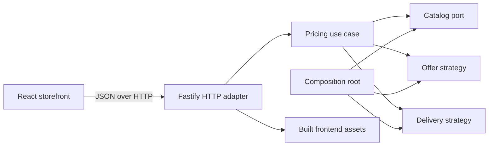

# Architecture

Designed, implemented & documented by **elitecoderdev — Luis Jimenez**.

Acme Widget Co. is a small modular monolith with a hexagonal pricing core. The central business problem is deterministic: calculate a basket from a catalog, an offer policy, and delivery bands. The solution makes those policies replaceable without making the exercise depend on a database, message broker, or distributed system.

## Boundaries

| Module            | Responsibility                                                                                     | Boundary                                                         |
| ----------------- | -------------------------------------------------------------------------------------------------- | ---------------------------------------------------------------- |
| `packages/domain` | Catalog model, basket calculation, offer and delivery policies                                     | Pure TypeScript; independent of HTTP, React, and cloud providers |
| `apps/api`        | Request validation, pricing orchestration, response serialization, health endpoints, static assets | Owns the server lifecycle and adapts HTTP to the pricing core    |
| `apps/web`        | Product selection, basket interaction, accessible feedback, price presentation                     | Calls the API; the server determines accepted prices             |
| `infra/terraform` | Artifact Registry, Cloud Run, runtime identity, scaling, probes                                    | Optional deployment adapter; not needed to run the challenge     |

Dependencies point toward the domain. The HTTP adapter can change without rewriting pricing. A new offer can implement a pricing strategy, and a new catalog can satisfy the catalog contract. Neither change requires product-specific conditionals inside a transport handler.

The browser and API ship together in one container and use the same origin. This keeps local and cloud behavior aligned and makes a release atomic. Vite builds the React application and the API's Node.js server bundle. The server bundle inlines the domain package and leaves Fastify and its plugins as external production dependencies. The boundary remains explicit enough to host static assets separately if delivery volume eventually justifies it.

## Pricing decisions

All arithmetic uses integer USD cents. Formatting happens at the edge. Prices supplied by a client never determine a quote.

| Product      | Code  | Unit price |
| ------------ | ----- | ---------: |
| Red Widget   | `R01` |     $32.95 |
| Green Widget | `G01` |     $24.95 |
| Blue Widget  | `B01` |      $7.95 |

For each pair of red widgets, the second costs $16.47. Half of $32.95 is $16.475; the discounted unit is rounded down to the nearest cent. This explicit rule reproduces the challenge's $54.37 total for two red widgets. The policy is applied per discounted unit, so two pairs do not change their rounding when grouped together.

Delivery uses the merchandise subtotal after offers:

| Discounted merchandise subtotal | Delivery |
| ------------------------------- | -------: |
| Empty basket                    |    $0.00 |
| Below $50.00                    |    $4.95 |
| $50.00 to below $90.00          |    $2.95 |
| $90.00 or more                  |    $0.00 |

| Challenge basket          |  Total |
| ------------------------- | -----: |
| `B01, G01`                | $37.85 |
| `R01, R01`                | $54.37 |
| `R01, G01`                | $60.85 |
| `B01, B01, R01, R01, R01` | $98.27 |

Unknown products and invalid quantities are rejected. Baskets are bounded at 100 units so application work and response sizes remain predictable. The browser receives a quote, not an order: inventory reservation, payment, tax, authentication, and order persistence are outside the challenge.

## Design principles in practice

The pricing core has one responsibility: calculate money from trusted policies. HTTP validation and rendering stay in their own modules. Policy interfaces support substitution and dependency inversion without a dependency injection framework. Shared domain definitions prevent duplicated business rules. Small functions and explicit names carry intent; source code contains no explanatory comments.

There is no database because every response is derived from the submitted basket and versioned pricing configuration. Persisting that result would introduce consistency and migration work without satisfying an additional requirement. If checkout becomes a requirement, it should own durable orders and record the accepted pricing version; a quotation alone must never be treated as a payment authorization.

## Scaling and tradeoffs

Requests do not depend on server sessions, shared disk, or another instance's memory. Cloud Run can distribute requests across identical containers and scale down when idle. The configured limits are 80 simultaneous requests per instance and at most 20 instances, with one CPU and 512 MiB per instance. These are starting settings, not a throughput claim.

Calculation is bounded by basket size and policy count. A larger catalog can move behind the catalog port; a growing static payload can move to a CDN. Only `POST /api/quotes` is rate limited, with a fixed aggregate allowance of 1,000 requests per minute per instance. The limiter does not trust client IP or forwarded headers, and it does not enforce a per-user or global quota. For client-aware edge limits, add Cloud Armor behind an external HTTP load balancer. That access layer is outside the base Terraform configuration.

Keep the current deployment until measurements or product requirements justify another service. The design supports change through boundaries, without paying distributed-system costs for a three-product exercise.

## Verification

The verification layers serve different purposes: domain tests prove arithmetic and policy boundaries; API tests prove input handling and transport behavior; component tests prove interaction states; browser tests exercise real user journeys; the container job verifies the production packaging. The coverage gate requires at least 95% coverage, but business examples and boundary assertions remain the primary evidence of correctness. Coverage does not measure Dockerfiles or Terraform; those have separate build and validation checks.
